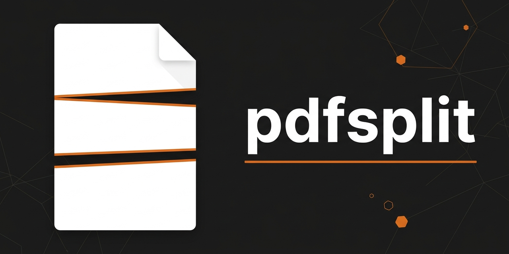
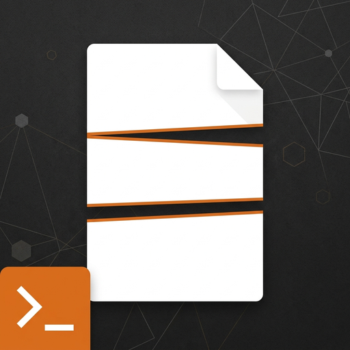

# pdfsplit



Taglia PDF enormi — decine di migliaia di pagine, diversi gigabyte — in parti, senza mai caricare
il documento in memoria.

Serve per i casi in cui gli strumenti normali si arrendono: un unico PDF da 6 GB con 73.868 pagine
diviso in due parti in meno di un minuto, con il picco di memoria sotto il gigabyte.

## Cosa fa

- **Legge la struttura a incrementi.** Tabelle `xref` e `xref stream`, object stream, file con più
  sezioni: ogni oggetto è letto quando serve, non tutti insieme.
- **Copia gli stream così come sono.** Nessuna ricodifica delle immagini o dei font: le parti si
  scrivono copiando i byte, quindi il tempo dipende dal disco e non dal contenuto.
- **Ricostruisce i segnalibri in ogni parte**, ricalcolando le destinazioni sulle pagine che la
  parte contiene davvero. Un link che punta a una pagina finita altrove diventa nullo, invece di
  trascinarsi dentro il resto del documento.
- **Quattro modi di tagliare**: elenco di pagine, N parti uguali, testo trovato nelle pagine,
  livello dei segnalibri.
- **Due interfacce**: `pdfsplit`, da console, e `pdfsplit-gui`, una finestra con fasi, avanzamento,
  stima del tempo rimasto e annulla. Ognuna ha la sua icona, incisa nell'eseguibile.

## Compilare

Serve Rust 1.95 o successivo.

```sh
cargo build --profile release-min                      # console
cargo build --profile release-min --features gui       # finestra
```

Il profilo `release-min` è quello della distribuzione: `opt-level = "s"`, LTO, `strip`, `panic
abort`. Produce `target/release-min/pdfsplit.exe` (circa 646 KiB) e, con la feature `gui`,
`pdfsplit-gui.exe` (circa 7,8 MiB, quasi tutto egui e wgpu).

I test:

```sh
cargo test --workspace
cargo test -p pdfsplit --features gui
```

Le icone stanno in `assets/` e `apps/pdfsplit/build.rs` le incide nei due eseguibili, insieme alle
proprietà del file (descrizione, prodotto, versione). Per rifarle dai disegni di partenza serve
Python con Pillow; il terzo argomento, se c'è, è il banner già composto per la pagina GitHub:

```sh
python tools/make-icons.py disegno-console.jpg disegno-finestra.jpg banner.jpg
```

L'anteprima sociale (`assets/social-preview.png`, 1280x640) è anche l'immagine in testa a questo
file. GitHub non la carica dal repository nella scheda del progetto: va scelta a mano in
*Settings → General → Social preview*.

## Uso

```
pdfsplit info <file.pdf>             che cos'è il file: peso, versione, pagine, segnalibri, cifratura
pdfsplit pages <file.pdf>            solo il numero di pagine
pdfsplit bookmarks <file.pdf>        l'indice come righe `livello<TAB>pagina<TAB>titolo`
pdfsplit search <file.pdf> <testo>   quali pagine contengono il testo
pdfsplit text <file.pdf> --page N    che cosa dice una pagina
pdfsplit split <file.pdf>            taglia il file in parti
pdfsplit --help                      questo testo
```

Esempi:

```sh
# un documento per ogni intestazione trovata nel testo, con il nome preso dalla riga
pdfsplit split "FILE_TEST_X_TRIM-PDF.pdf" --string "AVVISO DI PAGAMENTO TASSA RIFIUTI" --name-label "Documento N."

# le prime 35.308 pagine, il resto in un ultimo file, sostituendo quel che c'è già
pdfsplit split "FILE_TEST_X_TRIM-PDF.pdf" --pages 1-35308 --leftover --overwrite

# taglio per segnalibro di primo livello, comprimendo i flussi
pdfsplit split "Fattura 101.pdf" --bookmarks 1 --name-from-title --compress --out .\cartella-out
```

Le parti si chiamano, per esempio, `FILE_TEST_X_TRIM-PDF-01.pdf`, `-02.pdf`. Con `--prefix`,
`--suffix`, `--width` e `--start` si cambiano prefisso, suffisso, cifre e numero di partenza; con
`--always-number` la sequenza si aggiunge anche quando il nome viene dal testo.

## Prestazioni misurate

Su un PDF reale da 6,06 GB con 73.868 pagine, diviso in due parti da circa 37.000 pagine:

| | |
|---|---|
| durata | 00:00:49 |
| byte scritti | 6.104 MiB |

Il picco di memoria non cresce con il numero di pagine: su un fixture sintetico da 300.000 pagine
resta sotto i 700 MiB, perché il documento non viene mai letto tutto insieme.

La compressione dei flussi costa circa un minuto e mezzo in più sullo stesso file, perché ogni
stream va scompattato e ricompresso invece di essere copiato. Per questo le parti si scrivono, per
difetto, con la stessa versione PDF del sorgente.

## Limiti noti

- I riferimenti a pagine che finiscono in un'altra parte vengono azzerati: un link interno al
  documento non sopravvive al taglio.
- Del catalogo si portano le pagine, i segnalibri e `OCProperties`; `Info`, `Metadata`,
  `PageLabels`, `Names` e `StructTreeRoot` non vengono riscritti.
- Una parte non può essere scritta in una versione PDF più vecchia di 1.5 quando usa object stream
  e xref stream: in quel caso la versione del sorgente viene alzata e il report lo dice.

## Licenza

MIT oppure Apache-2.0, a scelta. Vedi [LICENSE-MIT](LICENSE-MIT) e [LICENSE-APACHE](LICENSE-APACHE),
e [NOTICE](NOTICE) per il codice di terzi incluso (`vendor/pdfcraft-filters`, derivato da
[PdfCraft](https://github.com/storytold/pdfcraft)).

---

# English — summary

**pdfsplit** cuts very large PDFs — tens of thousands of pages, several gigabytes — into parts,
without ever loading the document into memory. It is made for the cases where ordinary tools give
up: a single 6 GB PDF with 73,868 pages, split into two parts in under a minute.

- **Incremental structure.** `xref` tables and streams, object streams, files with several
  sections: every object is read at an absolute offset when it is needed, never all at once.
- **Streams are copied byte for byte.** Images and fonts are never re-encoded, so the time depends
  on the disk, not on the content.
- **Parts are rebuilt, not cut.** Each part gets a new page tree, contiguous object numbers and its
  own outline; a link to a page that ended up in another part becomes null instead of dragging the
  whole document inside, and form fields are trimmed to the widgets the part actually carries.
- **Four ways to cut**: page list, N equal parts, text found on the pages, bookmark level. Names
  come from a sequence or from the pages' own text.
- **Two interfaces**: `pdfsplit` on the console and `pdfsplit-gui`, a window with phases, progress,
  remaining time and cancel, plus a generated `.cmd` batch for the same job.

```sh
cargo build --profile release-min                    # console, about 646 KiB
cargo build --profile release-min --features gui      # window, about 7.8 MiB
```

Rust 1.95 or later; Windows is the platform the released `pdfsplit.exe` and `pdfsplit-gui.exe` are
built for. Parts are written, by default, in the PDF version of the source and without
recompressing the streams: compressing a 6 GB file costs about a minute and a half more, so the
default is the fast, faithful one and `--compress` is there when the size matters.

The design, the measurements and the open work are in [MD/](MD/); the plan for getting the
per-part dictionary table out of memory is in
[MD/m6-ram-dizionari.md](MD/m6-ram-dizionari.md).

Licence: MIT or Apache-2.0, at your choice. Bundled third-party code: `vendor/pdfcraft-filters`,
derived from [PdfCraft](https://github.com/storytold/pdfcraft).
