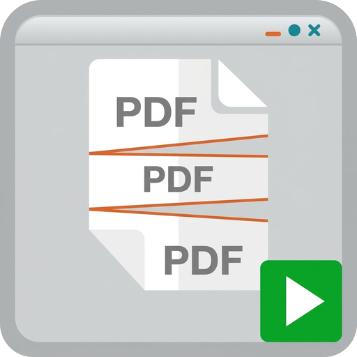

# pdfsplit

Taglia PDF enormi — decine di migliaia di pagine, diversi gigabyte — in parti, senza mai caricare
il documento in memoria.

Serve per i casi in cui gli strumenti normali si arrendono: un unico PDF da 6 GB con 73.868 pagine
diviso in due parti in meno di un minuto, con il picco di memoria sotto il gigabyte.

## Cosa fa

- **Legge la struttura a incrementi.** Tabelle `xref` e `xref stream`, object stream, file con più
  sezioni: ogni oggetto è letto quando serve, non tutti insieme.
- **Copia gli stream così come sono.** Nessuna ricodifica delle immagini o dei font: le parti si
  scrivono copiando i byte, quindi il tempo dipende dal disco e non dal contenuto.
- **Ricostruisce i segnalibri in ogni parte**, ricalcolando le destinazioni sulle pagine che la
  parte contiene davvero. Un link che punta a una pagina finita altrove diventa nullo, invece di
  trascinarsi dentro il resto del documento.
- **Quattro modi di tagliare**: elenco di pagine, N parti uguali, testo trovato nelle pagine,
  livello dei segnalibri.
- **Due interfacce**: `pdfsplit`, da console, e `pdfsplit-gui`, una finestra con fasi, avanzamento,
  stima del tempo rimasto e annulla. Ognuna ha la sua icona, incisa nell'eseguibile.

## Compilare

Serve Rust 1.95 o successivo.

```sh
cargo build --profile release-min                      # console
cargo build --profile release-min --features gui       # finestra
```

Il profilo `release-min` è quello della distribuzione: `opt-level = "s"`, LTO, `strip`, `panic
abort`. Produce `target/release-min/pdfsplit.exe` (circa 646 KiB) e, con la feature `gui`,
`pdfsplit-gui.exe` (circa 7,8 MiB, quasi tutto egui e wgpu).

I test:

```sh
cargo test --workspace
cargo test -p pdfsplit --features gui
```

Le icone stanno in `assets/` e `apps/pdfsplit/build.rs` le incide nei due eseguibili, insieme alle
proprietà del file (descrizione, prodotto, versione). Per rifarle dai due disegni di partenza serve
Python con Pillow:

```sh
python tools/make-icons.py disegno-console.png disegno-finestra.png
```

## Uso

```
pdfsplit info <file.pdf>             che cos'è il file: peso, versione, pagine, segnalibri, cifratura
pdfsplit pages <file.pdf>            solo il numero di pagine
pdfsplit bookmarks <file.pdf>        l'indice come righe `livello<TAB>pagina<TAB>titolo`
pdfsplit search <file.pdf> <testo>   quali pagine contengono il testo
pdfsplit text <file.pdf> --page N    che cosa dice una pagina
pdfsplit split <file.pdf>            taglia il file in parti
pdfsplit --help                      questo testo
```

Esempi:

```sh
# un documento per ogni intestazione trovata nel testo, con il nome preso dalla riga
pdfsplit split "FILE_TEST_X_TRIM-PDF.pdf" --string "AVVISO DI PAGAMENTO TASSA RIFIUTI" --name-label "Documento N."

# le prime 35.308 pagine, il resto in un ultimo file, sostituendo quel che c'è già
pdfsplit split "FILE_TEST_X_TRIM-PDF.pdf" --pages 1-35308 --leftover --overwrite

# taglio per segnalibro di primo livello, comprimendo i flussi
pdfsplit split "Fattura 101.pdf" --bookmarks 1 --name-from-title --compress --out .\cartella-out
```

Le parti si chiamano, per esempio, `FILE_TEST_X_TRIM-PDF-01.pdf`, `-02.pdf`. Con `--prefix`,
`--suffix`, `--width` e `--start` si cambiano prefisso, suffisso, cifre e numero di partenza; con
`--always-number` la sequenza si aggiunge anche quando il nome viene dal testo.

## Prestazioni misurate

Su un PDF reale da 6,06 GB con 73.868 pagine, diviso in due parti da circa 37.000 pagine:

| | |
|---|---|
| durata | 00:00:49 |
| byte scritti | 6.104 MiB |

Il picco di memoria non cresce con il numero di pagine: su un fixture sintetico da 300.000 pagine
resta sotto i 700 MiB, perché il documento non viene mai letto tutto insieme.

La compressione dei flussi costa circa un minuto e mezzo in più sullo stesso file, perché ogni
stream va scompattato e ricompresso invece di essere copiato. Per questo le parti si scrivono, per
difetto, con la stessa versione PDF del sorgente.

## Limiti noti

- I riferimenti a pagine che finiscono in un'altra parte vengono azzerati: un link interno al
  documento non sopravvive al taglio.
- Del catalogo si portano le pagine, i segnalibri e `OCProperties`; `Info`, `Metadata`,
  `PageLabels`, `Names` e `StructTreeRoot` non vengono riscritti.
- Una parte non può essere scritta in una versione PDF più vecchia di 1.5 quando usa object stream
  e xref stream: in quel caso la versione del sorgente viene alzata e il report lo dice.

## Licenza

MIT oppure Apache-2.0, a scelta. Vedi [LICENSE-MIT](LICENSE-MIT) e [LICENSE-APACHE](LICENSE-APACHE),
e [NOTICE](NOTICE) per il codice di terzi incluso (`vendor/pdfcraft-filters`, derivato da
[PdfCraft](https://github.com/storytold/pdfcraft)).

---

# English

Splits very large PDFs — tens of thousands of pages, several gigabytes — into parts, without ever
loading the document into memory.

It covers the cases where ordinary tools give up: a single 6 GB PDF with 73,868 pages, split into
two parts in under a minute, with peak memory below one gigabyte.

## What it does

- **Reads the structure incrementally.** `xref` tables and streams, object streams, files with
  several sections: each object is read when it is needed, never all at once.
- **Copies streams byte for byte.** No re-encoding of images or fonts: parts are written by copying
  bytes, so time depends on the disk and not on the content.
- **Rebuilds bookmarks in every part**, recomputing destinations against the pages that part really
  holds. A link pointing at a page that ended up elsewhere becomes null instead of dragging the
  rest of the document inside.
- **Four ways to cut**: page list, N equal parts, text found on pages, bookmark level.
- **Two interfaces**: `pdfsplit` on the console and `pdfsplit-gui`, a window with phases, progress,
  remaining-time estimate and cancel. Each has its own icon, embedded in the executable.

## Building

Rust 1.95 or later.

```sh
cargo build --profile release-min                      # console
cargo build --profile release-min --features gui       # window
```

The `release-min` profile is the distribution one: `opt-level = "s"`, LTO, `strip`, `panic abort`.
It produces `target/release-min/pdfsplit.exe` (about 646 KiB) and, with the `gui` feature,
`pdfsplit-gui.exe` (about 7.8 MiB, almost all of it egui and wgpu).

Tests:

```sh
cargo test --workspace
cargo test -p pdfsplit --features gui
```

Icons live in `assets/` and `apps/pdfsplit/build.rs` embeds them into both executables, together
with the file properties (description, product, version). Regenerating them from the two source
drawings needs Python with Pillow:

```sh
python tools/make-icons.py console-drawing.png window-drawing.png
```

## Usage

```
pdfsplit info <file.pdf>             what the file is: size, version, pages, bookmarks, encryption
pdfsplit pages <file.pdf>            the page count only
pdfsplit bookmarks <file.pdf>        the outline as `level<TAB>page<TAB>title` lines
pdfsplit search <file.pdf> <text>    which pages contain the text
pdfsplit text <file.pdf> --page N    what a page says
pdfsplit split <file.pdf>            cut the file into parts
pdfsplit --help                      this text
```

Examples:

```sh
# one document per heading found in the text, named after that line
pdfsplit split "FILE_TEST_X_TRIM-PDF.pdf" --string "AVVISO DI PAGAMENTO TASSA RIFIUTI" --name-label "Documento N."

# the first 35,308 pages, the rest in one last file, replacing anything already there
pdfsplit split "FILE_TEST_X_TRIM-PDF.pdf" --pages 1-35308 --leftover --overwrite

# cut at first-level bookmarks, compressing the streams
pdfsplit split "Fattura 101.pdf" --bookmarks 1 --name-from-title --compress --out .\out-dir
```

Parts are named, for example, `FILE_TEST_X_TRIM-PDF-01.pdf`, `-02.pdf`. `--prefix`, `--suffix`,
`--width` and `--start` change the prefix, the suffix, the number of digits and the first number;
`--always-number` adds the sequence even when the name comes from the text.

## Measured performance

On a real 6.06 GB PDF with 73,868 pages, split into two parts of about 37,000 pages:

| | |
|---|---|
| duration | 00:00:49 |
| bytes written | 6,104 MiB |

Peak memory does not grow with the page count: on a synthetic 300,000-page fixture it stays below
700 MiB, because the document is never read all at once.

Compressing the streams costs about a minute and a half more on the same file, because every stream
has to be decompressed and recompressed instead of copied. That is why parts are written, by
default, in the same PDF version as the source.

## Known limits

- References to pages that end up in another part are nulled: an internal link does not survive the
  cut.
- From the catalogue, pages, bookmarks and `OCProperties` are carried over; `Info`, `Metadata`,
  `PageLabels`, `Names` and `StructTreeRoot` are not rewritten.
- A part cannot be written in a PDF version older than 1.5 when it uses object streams and xref
  streams: in that case the source version is raised and the report says so.

## Licence

MIT or Apache-2.0, at your choice. See [LICENSE-MIT](LICENSE-MIT) and [LICENSE-APACHE](LICENSE-APACHE),
and [NOTICE](NOTICE) for the bundled third-party code (`vendor/pdfcraft-filters`, derived from
[PdfCraft](https://github.com/storytold/pdfcraft)).
